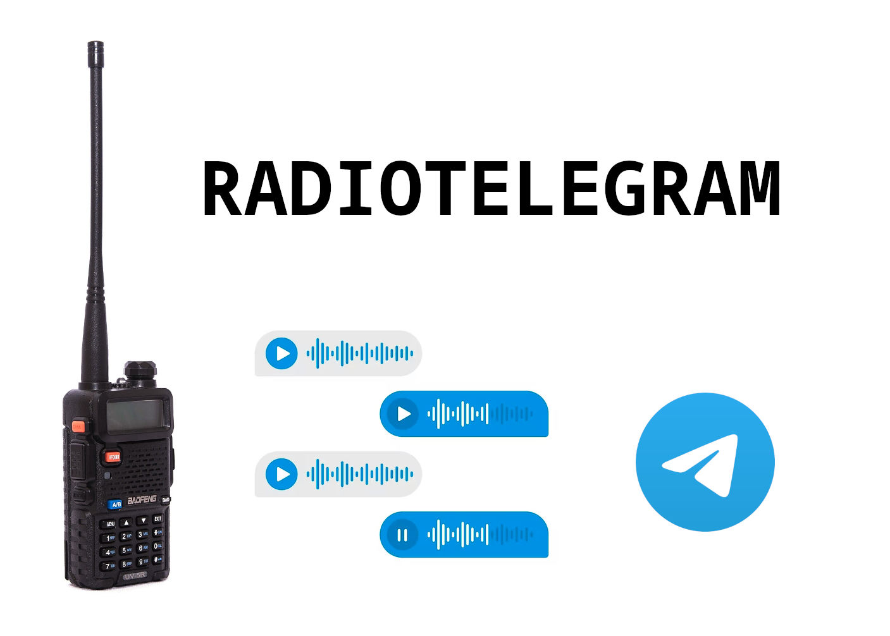
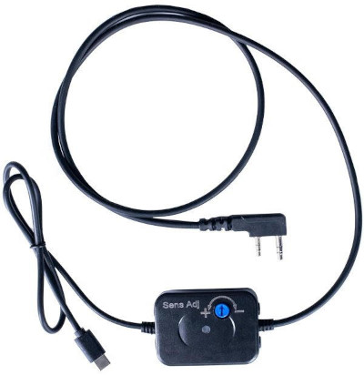
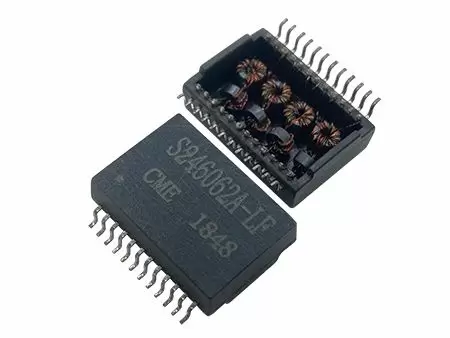
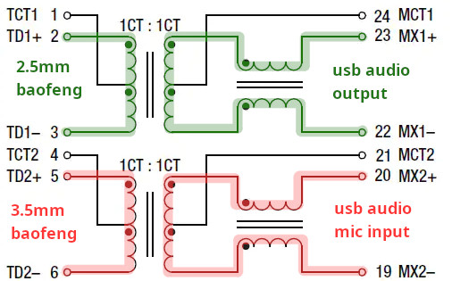

# radiotelegram

Telegram voice messages <> Baofeng radio RX/TX two-way bridge (half-duplex) with advanced audio processing.


## description
`radiotelegram` is a software-hardware project allowing you to to communicate with peers in Telegram chat using your handheld radio (walkie-talkie).
 - RX is recorded and sent to Telegram chat (topic) as a voice message.
 - incoming chat voice messages are played into radio TX with enhanced audio processing.

## enhanced audio processing features
- **Advanced Squelch**: Multi-criteria signal detection with spectral analysis and adaptive noise floor
- **Voice Detection**: [TEN-VAD](https://github.com/ten-framework/ten-vad) neural network voice activity detection with per-frame probability scoring
- **Radio-optimized Processing**: Pre-emphasis, bandpass filtering, and dynamic range compression
- **Noise Reduction**: Spectral noise reduction with adaptive thresholds
- **PTT Reliability**: Wake tone generation for consistent radio keying
- **Quality Enhancement**: Loudness normalization and overmodulation prevention 


## hardware
Hardware requirements:
- UR-5V Baofeng handheld radio (or compatible)
- PC audio adapter 
    - buy [APRS K1 PRO](https://baofengtech.com/product/aprs-k1-pro/) 
    - DIY adapter (see schematics below)




### adapter DIY guide
Components:
- (usb) audio card
- 2.5mm jack cable
- 3.5mm jack cable
- ethernet transformer — you can find one in unused electroncs: old routers, pc motherboards or other devices with ethernet ports.




| Jack             | Contact Points |
|------------------|----------------|
| 3.5mm Baofeng    | Sleeve, Ring   |
| 2.5mm Baofeng    | Sleeve, Tip    |
| 3.5mm Microphone | Sleeve, Tip    |
| 3.5mm Headphones | Sleeve, Tip    |

1. find a datasheet for your ethernet transformer
2. select two pairs as shown on the schematics
3. cut cables, solder wires, that's it
4. polarity is not that crucial, for voice it's ok both ways.


## config
1. copy `.env.example` to `.env`
2. edit file: fill bot token, group id and topic id (if present).

Voice detection and live squelch can be tuned with these optional environment
variables in `.env` or the process environment. Defaults preserve the existing
behavior; restart the application (or recreate the Docker container) after changes.

| Variable | Default | Effect |
|----------|---------|--------|
| `VAD_THRESHOLD` | `0.5` | TEN-VAD probability cutoff for each frame's voice flag, used by both detectors. |
| `VAD_MIN_VOICE_RATIO` | `0.01` | Minimum fraction of recorded frames flagged as voice. |
| `VAD_MIN_MAX_PROBABILITY` | `0.55` | Minimum peak voice probability in a recording. |
| `VAD_MIN_AVG_PROBABILITY` | `0.2` | Minimum average voice probability in a recording. |
| `VAD_MIN_ANALYSIS_DURATION` | `0.5` | Minimum recording length to analyze, in seconds. |
| `SQUELCH_OPEN_THRESHOLD` | `0.65` | Combined score required to start recording. |
| `SQUELCH_CLOSE_THRESHOLD` | `0.55` | Combined score required to keep the squelch open. |
| `SQUELCH_MIN_ABSOLUTE_LEVEL_DB` | `-40.0` | Audio level below which the squelch's level score is zero, in dBFS. |

Lower thresholds increase sensitivity and can admit more noise. The live squelch
uses an equal mix of audio-level score and VAD probability, so tune its open/close
thresholds to capture quieter speech; `VAD_THRESHOLD` changes frame flags, not that
combined score. A recording is sent only when its voice ratio, peak probability,
and average probability all exceed their configured minima.

Probabilities, ratios, and squelch scores must be between `0` and `1`, with
`SQUELCH_CLOSE_THRESHOLD <= SQUELCH_OPEN_THRESHOLD`. The minimum analysis duration
must be nonnegative, and the audio level must be at most `0` dBFS. All values must
be finite numbers; invalid settings stop startup with the variable name.

The TX wake-up tone before each voice message is also configurable:

| Variable | Default | Effect |
|----------|---------|--------|
| `TX_WAKE_TONE_FREQUENCY` | `1750` | Tone frequency in Hz, from `1` to `24000`. |
| `TX_WAKE_TONE_DURATION` | `0.3` | Tone duration in seconds; `0` disables the tone and following delay. |
| `TX_WAKE_TONE_DELAY` | `0.5` | Pause in seconds between the tone and voice playback. |

Duration and delay must be finite, nonnegative numbers. These settings work in
`.env` or the process environment, including Docker Compose, and take effect after
restarting the application or recreating the container.

## run with docker
```
docker compose up
```

On Linux ARM64 (`aarch64`), the container automatically builds TEN VAD's official
ONNX backend before starting the bridge. The image includes pinned, checksum-verified
TEN VAD sources and ONNX Runtime 1.22.0, so startup requires no network access.
The first start takes longer to compile; subsequent starts skip compilation and
reuse the extension from the `ten-vad-build` Docker volume, even after recreating
the container. Changes to the bundled build inputs, Python, or pybind11 invalidate
the cache. Remove the volume to force a rebuild. Linux x86_64 uses TEN VAD's packaged library.
Backend build or model-loading failures stop startup and appear in the container logs.

## raspberry pi

put these lines into `/boot/firmware/config.txt`

    dtparam=audio=off
    dtoverlay=vc4-kms-v3d,noaudio

to disable internal & hdmi audiocard

## run manually
```
sudo apt install ffmpeg python3-venv python3-dev build-essential 
```

> Note:
> `pyaudioop` was disconutinued in python3.13 so audioop-lts package is used.

    uv sync
    source ./venv/bin/activate
    python3 ./radiotelegram/main.py

## tuning (required for diy cards)

1. put baofeng into VOX mode (1/10).
2. adjust main volume knob so that audio doesn't clip (<100% volume).
3. adjust pc audio output volume so there is no voice distortion on the receiving end.

> less is more. do NOT use full volume.

# license
MIT

# credits
thx to claude sonnet 4 for comprehensive audio analysis and filter code generation, and opus 4.6 for integrating ten vad.
